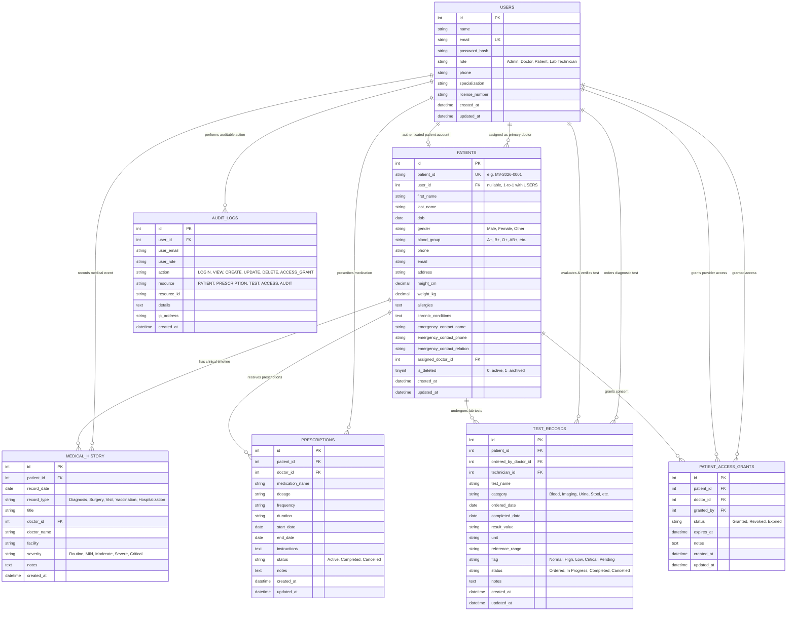

# MediVault: Entity-Relationship (ER) Architecture & Database Normalization

## 1. Relational Database Design Overview
MediVault is engineered on **MySQL 8.0+** using the **InnoDB** ACID-compliant transactional storage engine with **utf8mb4** encoding. The architecture models hospital record operations, role-based access control, medical histories, prescription safety, diagnostic lab workflows, and regulatory compliance logging.

---

## 2. Mermaid Entity-Relationship Diagram

---

## 3. Database Normalization Analysis

### First Normal Form (1NF)
- **Atomic Attributes**: All columns contain scalar, atomic values. Names are partitioned into `first_name` and `last_name`, addresses into structured fields, dates into native `DATE`/`DATETIME` types, and numbers into structured decimal/integer formats.
- **Unique Primary Keys**: Every entity has a surrogate auto-increment primary key (`id`) and immutable natural business identifiers (such as `patient_id` MV-YYYY-XXXX and `email`).
- **No Repeating Groups**: Prescriptions, test records, history timelines, and access authorizations are held in distinct normalized child tables rather than delimited strings or array columns.

### Second Normal Form (2NF)
- **1NF Compliance**: Satisfies all 1NF invariants.
- **Full Functional Dependency**: No non-key attribute depends on a subset of a composite candidate key. All entities utilize single-column surrogate keys (`id INT AUTO_INCREMENT PRIMARY KEY`), ensuring all non-key columns depend wholly on the entire primary key.
- **Composite Unique Constraints**: Constraints like `patient_access_grants(patient_id, doctor_id)` ensure uniqueness across relational pairs without creating partial dependencies.

### Third Normal Form (3NF)
- **2NF Compliance**: Satisfies all 2NF invariants.
- **Elimination of Transitive Dependencies**: Non-key attributes do not depend on other non-key attributes. For instance:
  - Doctor details (`specialization`, `license_number`) reside strictly in `users`, never duplicated in `patients`, `prescriptions`, or `test_records`.
  - Child tables reference `doctor_id` via foreign keys rather than storing redundant doctor profile data.
  - Calculated attributes such as patient age or body mass index (BMI) are derived dynamically via SQL functions (`TIMESTAMPDIFF`, `CURDATE()`, or views) rather than stored as persisted columns susceptible to update anomalies.

### Boyce-Codd Normal Form (BCNF)
- For every non-trivial functional dependency $X \rightarrow Y$, $X$ is a superkey.
- In `patient_access_grants`, `(patient_id, doctor_id)` uniquely determines the grant record and is declared as an explicit `UNIQUE KEY`, guaranteeing BCNF compliance.

---

## 4. Integrity Constraints & Foreign Key Rules

| Child Table | Foreign Key Column | Parent Table | On Delete Action | Rationale |
|---|---|---|---|---|
| `patients` | `user_id` | `users(id)` | `SET NULL` | Removing a login account does not delete clinical health records. |
| `patients` | `assigned_doctor_id` | `users(id)` | `SET NULL` | Provider reassignment or deactivation preserves patient record. |
| `medical_history` | `patient_id` | `patients(id)` | `CASCADE` | Timeline entries belong exclusively to the patient record. |
| `prescriptions` | `patient_id` | `patients(id)` | `CASCADE` | Patient deletion purges associated prescription records. |
| `prescriptions` | `doctor_id` | `users(id)` | `RESTRICT` | Physicians cannot be deleted if active prescription orders reference them. |
| `test_records` | `patient_id` | `patients(id)` | `CASCADE` | Diagnostics belong to the patient lifecycle. |
| `patient_access_grants`| `patient_id` | `patients(id)` | `CASCADE` | Consent grants are tied to the patient record. |
| `audit_logs` | `user_id` | `users(id)` | `SET NULL` | Compliance trails persist permanently even if accounts are purged. |

